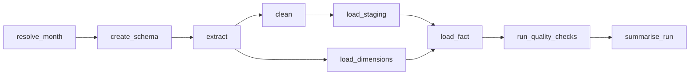

# Pipeline flow

DAG `nyc_taxi_etl` in `dags/nyc_taxi_etl.py`. **One run loads one month.**

| Task | What it does | Code |
|---|---|---|
| `resolve_month` | Uses the `month` param, else the run's logical date | DAG |
| `create_schema` | Creates schemas and tables if missing, seeds static dimensions | `sql/schema.sql`, `sql/seed_dimensions.sql` |
| `extract` | Ensures the raw parquet file and zone lookup are in `data/input/`; downloads them if missing | `src/extract/fetch_data.py` |
| `clean` | Applies the [cleaning rules](business_rules.md), writes `data/output/yellow_tripdata_clean_YYYY-MM.parquet` | `src/transform/clean_trips.py` |
| `load_staging` | Truncates `staging.stg_trips` and bulk-loads the clean file with `COPY` in batches | `src/load/load_to_db.py` |
| `load_dimensions` | Refreshes `dim_location` from the zone lookup and extends `dim_date` for the month | `sql/queries/load_dim_*.sql` |
| `load_fact` | Creates the month partition if needed, truncates it and inserts from staging, in one transaction | `sql/queries/load_fact.sql` |
| `run_quality_checks` | Fails the run if a [quality check](business_rules.md#post-load-quality-checks) fails | `src/quality/checks.py` |
| `summarise_run` | Logs the run summary and fails the run if any step did not succeed (`trigger_rule=all_done`) | DAG |

## Schedule

| Setting | Default |
|---|---|
| `DAG_SCHEDULE` | `@monthly` |
| `DAG_START_DATE` .. `DAG_END_DATE` | `2023-01-01` .. `2023-02-28` |
| `DAG_CATCHUP` | `true` |
| `DAG_MAX_ACTIVE_RUNS` | `1` (all months share the staging table) |

The run for month M has logical date M-01 and fires on the first day of month M+1.

## Idempotency

Re-running a month replaces exactly that month: `load_fact` truncates and reloads its partition inside one transaction, and staging is truncated at the start of every load. Readers never see a half-loaded month.

## Failure handling

- Retries with exponential backoff: `TASK_RETRIES` (2), starting at `TASK_RETRY_DELAY_S` (30 s), up to `TASK_MAX_RETRY_DELAY_MIN` (5 min). Quality checks and the summary do not retry.
- Per-task timeout: `TASK_EXECUTION_TIMEOUT_MIN` (30 min).
- `on_retry_callback` logs each retry; `on_failure_callback` logs an ERROR alert and posts to `ALERT_WEBHOOK_URL` if set (`src/utils/alerts.py`).

## Monitoring

- Every step writes one row to `dw.etl_run_audit`: status, timings, `rows_in`, `rows_out`, `rows_rejected`, `details` (e.g. rejects per rule) and `error_message` (`src/utils/audit.py`).
- JSON log lines go to stdout (Airflow task log) and, when `ETL_LOG_DIR` is set, to `logs/etl/pipeline.jsonl`.
- Airflow's own task logs are under `logs/dag_id=nyc_taxi_etl/`.
