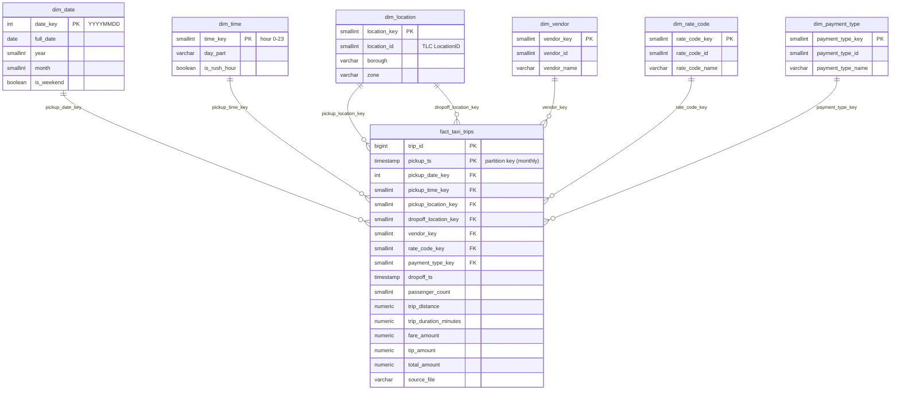

# Entity-relationship diagram

Star schema in the `dw` schema, defined in `sql/schema.sql`. Grain of the fact table: **one row per completed taxi trip**. Full column list: [data_dictionary.csv](data_dictionary.csv).

The fact table also carries `extra`, `mta_tax`, `tolls_amount`, `improvement_surcharge`, `congestion_surcharge`, `airport_fee` and `loaded_at` (omitted above for readability).

## Notes

- `dim_location` is a role-playing dimension: the fact references it twice, as pickup and drop-off.
- `dim_vendor`, `dim_rate_code` and `dim_payment_type` hold an `Unknown` row with key 0, so fact foreign keys are never NULL.
- `dw.fact_taxi_trips` is range-partitioned by month on `pickup_ts`; partitions are created by `src/load/load_to_db.py`.

## Outside the star

| Table | Role |
|---|---|
| `staging.stg_trips` | UNLOGGED landing table for cleaned trips, truncated every run |
| `staging.stg_zones` | UNLOGGED landing table for the zone lookup CSV |
| `dw.etl_run_audit` | One row per pipeline step attempt (monitoring trail) |
